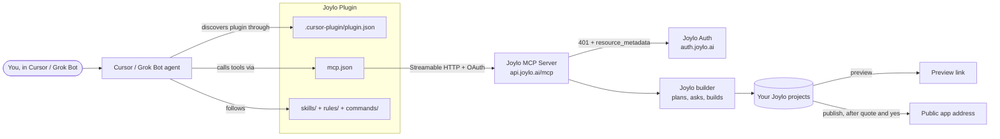

# Architecture

How the Joylo plugin connects Cursor / Grok Bot to Joylo.

## The pieces

- **plugin.json** is the plugin's manifest. Cursor uses it to recognise the plugin.
- **mcp.json** tells the client where Joylo's server lives. There are no keys in it.
- **skills, rules, commands** tell the agent how to use the tools safely: follow builds, pass questions to you, verify code, and never spend credits or publish without your explicit yes.
- **Joylo MCP Server** is Joylo's hosted service. It is not in this repo. You sign in once in your browser through Joylo Auth (OAuth 2.1 with PKCE and dynamic client registration).
- **Joylo builder** is Joylo's own AI, which plans, asks questions, and writes the app.

Authentication and all project operations happen in Joylo's service, not in code in this plugin.
